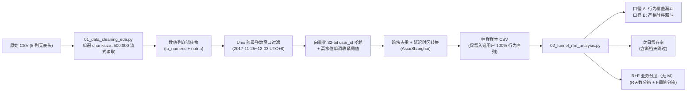

# 淘宝用户行为分析工程（Taobao User Behavior Analysis v2）

[](https://github.com/12baixic-del/taobao-user-behavior-analysis/actions/workflows/ci.yml)

面向亿级电商行为日志的**可复现数据清洗、流式整群抽样、双口径转化漏斗与 R+F 用户分层（无 M）分析工程**。  
本项目以阿里云天池淘宝用户行为数据集为业务背景，重点解决大规模行为数据下的**单机内存受控处理、用户序列完整性、时区口径一致性、购买频次分箱退化**及**自动化回归测试**等核心工程与统计问题。

> [!IMPORTANT]
> **版本与数据状态声明（v2）**
> - 本分支（v2）已完成流式清洗抽样、UTC+8 时区修正、R+F 分层、覆盖/时序双漏斗及 21 项自动化测试的工程重构。
> - **真实数据复算已完成（2026-11-13）**：100,150,807 行全量扫描，业务结论见 REPORT.md §3。
> - 仓库早期 v1 版本的输出（含 `527,696` 人、`3.99%` 转化率与旧 RFM 结果）存在按行抽样与口径偏差，已完整归档至 [`docs/legacy/REPORT_v1.md`](docs/legacy/REPORT_v1.md) 与 [`outputs/legacy_v1/`](outputs/legacy_v1/README.md) 仅作历史追溯，**不作为 v2 新版分析结论**。

---

## 1. 项目背景与业务问题

在典型电商平台中，用户从浏览商品（`pv`）到加购（`cart`）/ 收藏（`fav`），再到最终下单购买（`buy`），呈现出显著的漏斗流失与长尾分布特征。围绕双 12 预热期 9 天（`2017-11-25` 至 `2017-12-03`）的用户行为日志，本项目聚焦四个核心业务与工程问题：

1. **核心转化瓶颈定位**：用户是在“浏览 → 意向（加购/收藏）”阶段流失，还是在“意向 → 支付”阶段流失？不同漏斗口径（覆盖口径 vs 严格时序口径）差异有多大？
2. **高价值用户识别与流失预警**：在实测 31.9% 用户零购买、且 9 天窗口内 R 维度退化的分布下，如何避免分层失效并准确表述购买频次分层？
3. **短期用户留存表现**：日活（UV）波动与次日留存率走势如何？
4. **单机亿级日志工程可行性**：如何在不依赖分布式集群的条件下，使用单机 Python 对亿级 CSV 进行内存恒定受控的清洗与完整用户序列抽样？

---

## 2. 数据来源与许可

- **数据集**：阿里云天池 [User Behavior Data from Taobao for Recommendation（Dataset 649）](https://tianchi.aliyun.com/dataset/649)
- **原始规模**：`100,150,807` 条行为记录，`987,994` 名用户，时间跨度 `2017-11-25` 至 `2017-12-03`（9 天），原始 CSV 约 3–4 GB
- **字段说明**：`user_id`、`item_id`、`category_id`、`behavior_type`（`pv` / `cart` / `fav` / `buy`）、`timestamp`（Unix 秒级时间戳）
- **数据局限**：不含订单金额/商品价格（故 RFM 不含 M 维度，以购买频次 F 替代）、无类目中文名称
- **许可协议**：数据遵循 **CC BY-NC-SA 4.0**，仅限学习与研究使用，仓库不存放原始大文件（见 `.gitignore`）

---

## 3. 技术栈

| 类别 | 工具 / 库 | 用途 |
| :--- | :--- | :--- |
| 数据处理 | `Python 3.13` / `pandas>=2.0` / `numpy>=1.24` | 单遍分块流式读取、向量化哈希抽样、分组聚合 |
| 可视化 | `matplotlib>=3.6` / `seaborn>=0.13` | 趋势图、漏斗图、留存率与 RFM 分层柱状图（`Agg` 无头渲染） |
| 性能与内存度量 | `psutil>=5.9` | 独立子进程测量 `peak_wset`（峰值工作集）与内存增量 |
| 质量保障与 CI | `unittest` / `GitHub Actions` | 21 项单元测试/边界测试/回归测试与自动 CI 门禁 |

---

## 4. 项目目录结构

```text
taobao-user-behavior-analysis/
├── .github/workflows/ci.yml        # GitHub Actions 自动化测试工作流
├── benchmarks/
│   ├── README.md                   # 基准测试环境、方法与测量口径说明
│   ├── benchmark_streaming.py      # 第五阶段公平对比与 10万/100万/1000万行分级压测脚本
│   └── benchmark_phase5_results.json # 基准实测输出 JSON（合成数据）
├── data/
│   ├── README.md                   # 天池原始数据下载与校验说明
│   └── raw/                        # 原始 UserBehavior.csv 存放目录（已由 .gitignore 排除）
├── docs/legacy/
│   └── REPORT_v1.md                # v1 历史分析报告归档（仅作追溯，非当前结论）
├── notebooks/
│   ├── 01_data_cleaning_eda.py     # 单遍流式清洗 + 自适应 user_id 整群抽样 + EDA
│   └── 02_funnel_rfm_analysis.py   # 覆盖/时序双漏斗 + 次日留存 + R+F 分层（无 M）
├── outputs/
│   ├── top_categories.csv / funnel_nonpath_split.csv / funnel_cross_item.csv  # 看板小表（已提交，无需原始样本）
│   └── legacy_v1/                  # v1 历史汇总 CSV 与图表归档（已标注历史口径说明）
├── tests/
│   ├── test_analysis.py            # 16 项单元/边界/回归测试（含跨 chunk 完整度与脏行容错）
│   └── test_sql_funnel.py          # 3 项 SQL 实测（Q3/Q9/Q9b 同秒/反序/跨商品时序规则）
├── .gitignore                      # 排除原始 CSV、抽样大表、缓存、虚拟环境与密钥
├── REPORT.md                       # v2 分析框架、口径说明与历史对比报告
├── README.md                       # 项目工程文档
└── requirements.txt                # 精确依赖清单
```

---

## 5. 数据处理与分析架构



---

## 6. 核心方法与质量控制设计

### 6.1 用户级整群流式抽样（解决序列截断与 OOM）
- **旧版问题**：按行随机抽样（`df.sample`）会随机丢弃同一用户的部分行为，使“浏览 → 加购 → 购买”序列断裂，导致漏斗转化率与留存率失真；一次性 `pd.read_csv` 在亿级数据下存在内存溢出风险。
- **v2 方案**（`stream_clean_and_sample`）：
  1. **单遍分块流式读取**（`chunksize=500,000`），避免两遍扫描的重复 I/O；
  2. **向量化确定性哈希**：对 `user_id` 计算固定种子 `seed=42` 的 32-bit 乘法哈希并归一化至 `[0, 1)`，同一用户在所有分块中始终得到相同哈希值；
  3. **高水位单调阈值收紧**：当暂存行数超过 `high_water = max(target_rows + chunksize, int(target_rows * 1.25))` 时，通过 `_tighten_threshold()` 严格单调下调哈希阈值并淘汰超阈值用户（含单一大户极端倾斜保护，保证至少保留 1 名用户、不死循环），**确保最终入选的每一位用户的全周期行为记录 100% 完整保留**；
  4. **样本局限声明**：抽样结果属于“用户整群样本”，分析报告须明确标注样本量与抽样策略，不得将样本绝对人数冒充全量 1 亿行总体指标。

### 6.2 时间转换与活跃天数修复
- **UTC → 北京时间（`Asia/Shanghai`, `UTC+8`）**：
  - 过滤阶段直接通过 `_window_epoch_bounds()` 将北京时间窗口边界 `[2017-11-25 00:00:00, 2017-12-03 23:59:59]` 换算为 Unix 秒级整数直接比对，避免在每块上重复构建时区对象；
  - 仅对最终留存样本执行一次 `pd.to_datetime(unit="s", utc=True).dt.tz_convert("Asia/Shanghai").dt.tz_localize(None)`。
- **`days_since_last_active` 负数修复**：使用 `compute_days_since_last_active()` 统一基于用户最后活跃日期与观察日 `OBSERVE_DATE` 计算天数差，并执行 `.clip(lower=0)` 截断，杜绝观察日早于数据末日或跨时区导致的负值。

### 6.3 R+F 业务分层规则（无 M；实测零购买 31.9%）
由于数据不含金额（M），工程采用 `R + F` 二维规则分层。旧版使用 `rank(pct=True)` 导致大量零购买用户并列同分、分层退化；v2 改为**业务明确阈值分箱**。实测零购买为 31.9%（非旧版假设的 96%+），且 9 天窗口内 R 维度退化（99.86% 的用户 R=5），分层实际是单维 F，五类框架产出四类，详见 REPORT.md §2.3：

- **R_score（距观察日天数 `days_since_last_active`）**：`0-1天=5`、`2-3天=4`、`4-5天=3`、`6-7天=2`、`>=8天=1`
- **F_score（窗口内购买次数 `buy_count`）**：`0次=1`、`1次=2`、`2次=3`、`3-4次=4`、`>=5次=5`

| 用户分层 | 判定规则 | 业务含义与运营策略 |
| :--- | :--- | :--- |
| **重要价值用户** | `F >= 3` 且 `R >= 4` | 9 天内购买 ≥2 次（4,467 人，44.4%），平均购买 3.95 次；不得表述为高价值客户占比，侧重复购激励 |
| **流失风险的高价值用户** | `F >= 3` 且 `R <= 3` | 历史多次下单但近期不活跃；本次复算 0 人 |
| **潜力新客（首单待复购）** | `F == 2` 且 `R >= 4` | 近期完成首单且活跃，重点推送关联商品与二次复购券 |
| **一般活跃未购用户** | `F == 1` 且 `R >= 4` | 近期有浏览/加购/收藏但未成单，需通过限时优惠或降价提醒促转化 |
| **低频/沉睡用户** | 其余组合 | 仅 2 人（仅窗口首日活跃），9 天窗口内不构成沉睡，改述或删除该类 |

### 6.4 双口径漏斗与数值安全防护
为消除单一口径误导，脚本同时输出两张漏斗表，所有除法均通过 `safe_div()` 防护除零、`NaN` 与 `inf`：
- **口径 A（`funnel_summary.csv` — 普通行为覆盖漏斗）**：分别统计 `pv`、`cart`、`fav`、`cart_or_fav`、`buy` 的**独立用户数**与**行为次数**（不强制要求行为发生的先后顺序，并将 `cart` 与 `fav` 并列展示）。
- **口径 B（`funnel_sequential_summary.csv` — 严格时序转化漏斗）**：按用户时间轴严格要求 `首次 pv` $\le$ `首次意向 (cart|fav)` $\le$ `后续 buy`，剔除先买后逛或孤立加购等反序行为。

---

## 7. 性能优化成果（第五阶段实测）

为验证单遍流式方案的速度与内存边界，使用 [`benchmarks/benchmark_streaming.py`](benchmarks/benchmark_streaming.py) 在独立子进程中对不同规模**合成数据**进行了测试：

- **测试机器与环境**：Windows 11 (`10.0.26200-SP0`)，22 核逻辑 CPU，15.5 GB RAM，Python `3.13.14`
- **数据与采样口径**：固定随机种子 `seed=42` 生成 5 列合成 CSV（`pv:cart:fav:buy = 0.89:0.055:0.03:0.025`），`chunksize=500,000`，`target_rows=100,000`（10 万行横向对比设为 `target_rows=20,000`）
- **度量口径**：`psutil.Process().memory_info().peak_wset` 测量进程峰值工作集，耗时包含 CSV 读取、流式清洗抽样、下游双口径漏斗与 RFM 计算

> [!NOTE]
> 以下性能指标均来自**固定随机种子的合成数据基准**，用于验证流式算法吞吐与内存上界，**不能等同或描述为一亿行真实淘宝 `UserBehavior.csv` 的实测性能**。

1. **10 万行同输入横向对比（3 次重复均值）**：
   - 旧版全量读入（`legacy_full`）：平均耗时 `0.0849 s`，峰值工作集 `127.62 MB`（增量 `+28.29 MB`）
   - 第四阶段两遍流式（`phase4_twopass`）：平均耗时 `0.1568 s`，峰值工作集 `130.49 MB`（增量 `+30.91 MB`）
   - **第五阶段单遍向量化流式（`phase5_singlepass`）**：平均耗时 **`0.0964 s`**（较两遍流式提速 **38.5%**），峰值工作集 **`123.20 MB`**（增量 **`+23.60 MB`**）
2. **分级规模压测（10 万 / 100 万 / 1000 万行）**：
   - `10 万行`（2.92 MB CSV）：耗时 `0.0801 s`，峰值工作集 `127.80 MB`（增量 `+28.45 MB`），入选用户序列完整度 `100%`
   - `100 万行`（30.15 MB CSV）：单遍流式耗时 **`0.6678 s`**（对比两遍流式 `1.0955 s` 提速 **39.0%**），峰值工作集 `241.45 MB`（增量 `+141.24 MB`），序列完整度 `100%`
   - **`1000 万行`（310.99 MB CSV）**：单遍流式约耗时 **`5.30 s`**（实测 `5.3018 s`），报告峰值工作集约 **`249.89 MB`**（增量 `+149.90 MB`），入选 `5,018` 名用户的 `100,000` 条记录 `100%` 完整保留（`completeness_diff_rows = 0`）

从 100 万行扩展 10 倍至 1000 万行时，峰值工作集仅微增约 `8.44 MB`，验证了单遍流式框架的恒定内存特征。

---

## 8. 自动化测试

[`tests/`](tests/) 共 **21 项自动化测试**（`test_analysis.py` 17 项 +
[`test_sql_funnel.py`](tests/test_sql_funnel.py) 4 项），覆盖：
- UTC → 北京时间（`UTC+8`）秒级上下边界过滤
- 跨分块去重与自适应阈值收紧下的 `user_id` 完整序列保留（`len(sampled) < 400` 且全序列无截断）
- 脏行容错（缺失 `user_id`、非法字符串时间戳）与单一大户极端倾斜保护（不崩溃、不删空）
- `target_rows <= 0` 与 `chunksize <= 0` 参数边界校验
- 实测 31.9% 零购买分布下 R+F 分层及 `days_since_last_active` 负数截断
- 覆盖漏斗 vs 严格时序漏斗的反序行为区分与除零/`NaN`/`inf` 安全防护
- 时序规则：同秒意向/购买计入路径（`>=`）、反序行为剔除、跨商品路径按用户级计入
- SQL 实测：对合成数据直接运行 `sql/queries.sql` 的 Q3/Q9/Q9b，验证
  同秒/反序/跨商品用例与 1,510 人分流（767 无意向 / 743 顺序不满足）

```bash
python -m unittest discover -s tests -v
```

---

## 9. 从零运行指南

### 9.1 安装依赖与运行测试（无需原始数据）
```bash
git clone https://github.com/12baixic-del/taobao-user-behavior-analysis.git
cd taobao-user-behavior-analysis
pip install -r requirements.txt

# 1. 运行 21 项自动化测试
python -m unittest discover -s tests -v

# 2. 复现合成数据性能基准（可选，将生成并清理临时 10万/100万/1000万行 CSV）
python benchmarks/benchmark_streaming.py
```

### 9.2 使用真实淘宝数据集运行全流程
1. 按 [`data/README.md`](data/README.md) 指引从天池下载 `UserBehavior.csv`，放置于 `data/raw/UserBehavior.csv`。
2. 依次运行清洗与分析脚本：
```bash
python notebooks/01_data_cleaning_eda.py
python notebooks/02_funnel_rfm_analysis.py
```
3. 查看 `outputs/` 生成的新版汇总 CSV 与 `outputs/figures/` 图表。

---

## 10. 当前局限与后续计划

- **真实数据已复算（2026-11-13）**：100,150,807 行全量扫描完成，漏斗、留存与 R+F 分层结论见 REPORT.md §3；样本为 10,053 用户整群抽样（总体 1.02%）。
- **字段客观局限**：原始数据无价格/订单金额与类目中文名，无法核算 GMV，RFM 模型缺少 M 维度；9 天窗口仅反映双 12 预热期特征，难以度量月度复购周期。
- **后续计划**：
  - ~~补齐 SQL 业务查询（T1-3）与 Streamlit 看板（T1-4）~~ **已完成（2026-11-13）**：SQL 11 条业务查询见 `sql/`（Q1–Q5 与 Python 版逐项对上，0 差异；Q6/Q7/Q9/Q9b/Q10 为 SQL 新发现，Q9b 为 1,510 人分流）；Streamlit 看板见 `app.py`，演示流程见 `docs/demo-guide.md`，管理层摘要见 `docs/management-summary.md`。
  - 类目与分时段下钻**已部分完成**：Top 10 类目与分时段转化见 `sql/README.md`（Q6/Q7）；下一步可按类目下钻转化漏斗（分时段 × 类目交叉）与月度复购验证（需更长窗口数据）。
  - 待办：Codex 终审（Codex CLI 环境缺失，待修复后补跑）。
